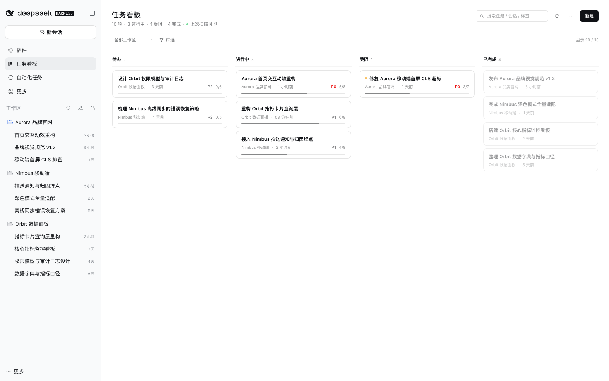
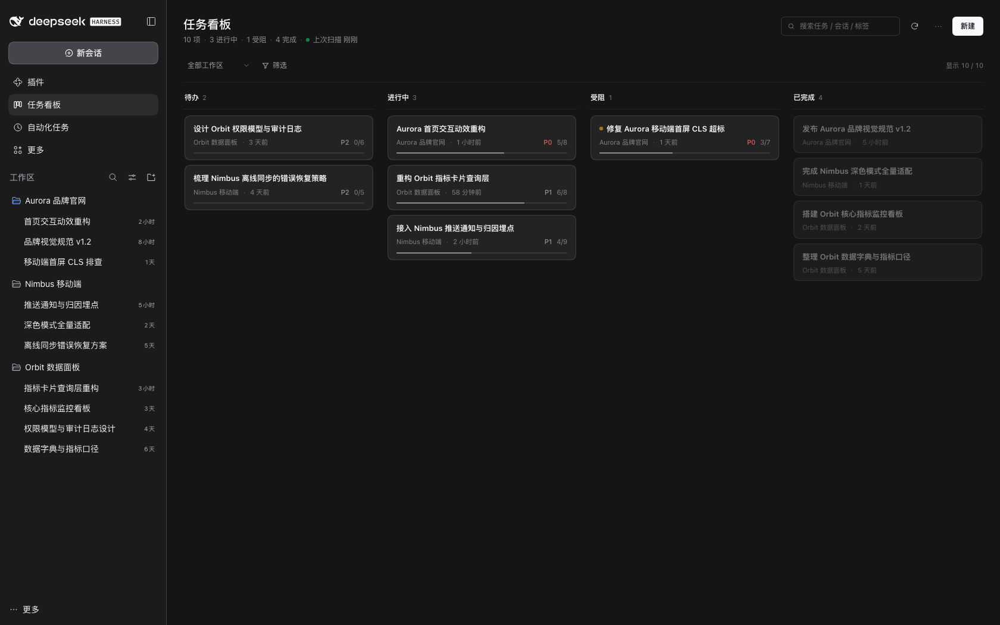
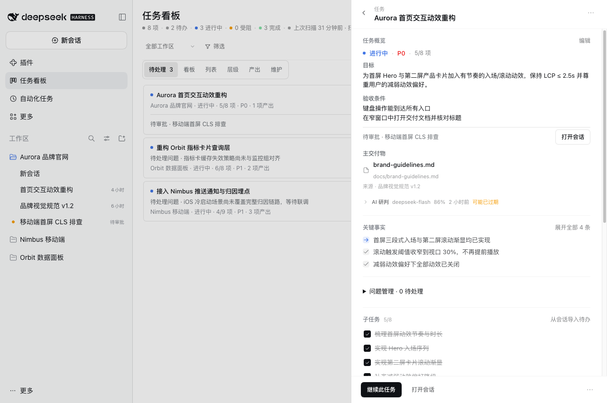
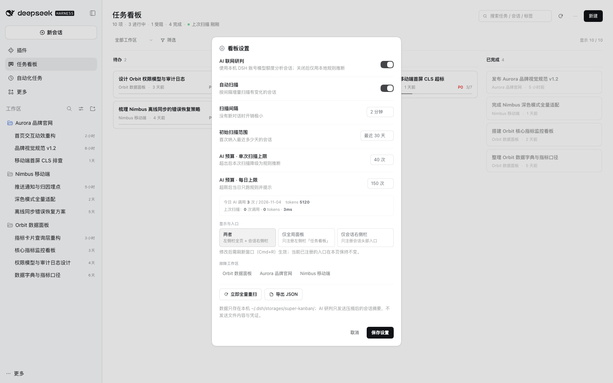
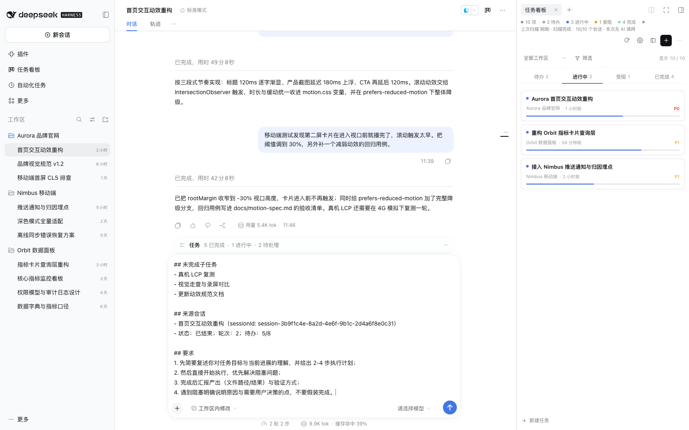

# Super Kanban · AI Task Command Center

**Turns your DSH sessions into a task board that keeps itself up to date.** You keep several DSH sessions going at once — what got done, where it is stuck, whether anything shipped — and the board answers that without scrolling back through chats. Every card traces back to a specific session and a specific sentence.

**English** | [简体中文](https://github.com/topmindspace/dsh-super-kanban/blob/main/README.md)

> Requires DSH `>= 0.2.1-rc.5 < 0.3.0` · Node.js `>= 22.19.0` · zero third-party dependencies · no telemetry

## At a glance

- **Who it is for**: people running several DSH sessions at once who want one glance at "what got done today / what is stuck".
- **Who it is not for**: single-session work where DSH's own todo list is already enough.
- **The difference**: tasks grow out of your sessions automatically instead of being maintained by hand; AI is only an enhancement, and the local rules engine still works when AI is off or unavailable.

## Quick start

### Install (three common ways, local/source install also supported)

All three common ways support **exact versions**; local directory / source install is covered in step 3.

1. **Plugin market (recommended)**: DSH → Plugins → Discover → add the index source `https://topmindspace.github.io/dsh-super-kanban/index.json` → open **Super Kanban** → in the **version list** pick an exact version (for example `0.6.0`) → install → enable and reload the window.
2. **npm (exact version)**: DSH → Plugins → Add plugin → enter `dsh-super-kanban@0.6.0` → install → reload the window. Command-line equivalent: `dsh plugin --profile desktop add dsh-super-kanban@0.6.0`.
3. **Git / source (tag-pinned version)**: `git clone https://github.com/topmindspace/dsh-super-kanban.git` → `git checkout v0.6.0` → `./install.sh -y` → reload the window. `./install.sh` needs `bash` + `python3`; if you prefer no command line, pick the local directory in the DSH plugin page instead. Adding the repository directly in the plugin page pins the latest commit, so use this tag flow when you need a fixed version.

[Verify version](https://github.com/topmindspace/dsh-super-kanban/blob/main/docs/INSTALL.md#23-命令行查看实际安装版本) · [Upgrade](https://github.com/topmindspace/dsh-super-kanban/blob/main/docs/INSTALL.md#3-更新插件升级) · [Rollback](https://github.com/topmindspace/dsh-super-kanban/blob/main/docs/INSTALL.md#4-回滚到旧版本) · [Local directory install](https://github.com/topmindspace/dsh-super-kanban/blob/main/docs/INSTALL.md#方式-d本地目录源码脚本) — full steps in the [installation guide](https://github.com/topmindspace/dsh-super-kanban/blob/main/docs/INSTALL.md).

### First run (5 steps)

1. Click **任务看板** (Task board) in the left sidebar (or the board icon in a conversation header for the right-sidebar layout). The UI is currently in Chinese.
2. In **Settings**, check the scan scope. If you enable AI, the model follows the DSH default unless you select another.
3. Click **Scan**; the first scan takes seconds to minutes depending on session count, and the outcome stays in the stats line — you can cancel at any time.
4. Open **待处理** (Inbox) to jump to a session that needs you or open a card to see its acceptance criteria and main deliverable.
5. Select **继续此任务** (Continue task) or **验收产出** (Review deliverables). Review the draft, place it in a linked or new session, and send it yourself.

## What it does

- **See what needs your attention**: the inbox groups approvals, issues, dependencies and deliverables awaiting review, with links to the relevant sessions.
- **One goal across sessions**: link progress and deliverables from several sessions. Incremental scans update existing cards.
- **Review against criteria**: find the main deliverable, blockers and evidence by source session. Human acceptance is recorded on the card.
- **Continue with context**: local templates carry acceptance criteria, open work and artifacts into the session draft you choose.
- **AI is optional, the model is yours**: follow the DSH default model or pick a third-party model configured in DSH; when AI is off or unavailable it falls back to local rules.
- **Two layouts**: a full four-column board, or a compact board in the conversation's right sidebar that adapts to its width.
- **Manage and recover**: pin, batch archive, lock fields or explicitly merge. Restore deleted cards and import backups from the maintenance view.
- **Local-first**: board data is written only to `~/.dsh/storages/super-kanban/` on your machine, and the board itself has no telemetry.

## Typical scenarios

- **Every morning in 30 seconds**: open the board, scan the stats line and the four columns, and you know what shipped yesterday and what is blocked.
- **Keep one card moving**: click "继续此任务" in the drawer and the prompt goes straight back to the original or a new session — no context rebuilding by hand.
- **Maintain a large board manually**: create, drag and lock fields; a field you locked will not be overwritten by the next AI analysis.

## AI and models

- **Follows the DSH default model by default** — you do not enter any key in the board.
- **Using a third-party model**: add a model provider in **DSH Settings → Models** (OpenAI / Anthropic / OpenRouter and similar, or a custom compatible endpoint) and enter its API key; then pick it under board Settings → "AI 研判模型".
- **Without a native model service** (old DSH or a minimal composition) the board switches to the local rules engine automatically and explains why in the scan outcome.
- **Privacy**: analysis sends a compact session digest and limited related task details. Choosing AI Polish sends the current draft. The configured DSH model provider receives these requests. See [SECURITY.md](https://github.com/topmindspace/dsh-super-kanban/blob/main/SECURITY.md).

## Settings and budget

- **AI budget**: "Auto" by default = use up to the daily remainder per scan; or fix it at 20 / 40 / 80 / 150 calls.
- **Daily limit**: 150 budget units by default, reset at local midnight (budget units are not a hard cost cap).
- **Scanning**: the auto-scan interval is configurable; sessions a scan could not finish continue on the next scan, and the outcome says "remaining N sessions continue next scan".
- **Entry preferences**: "Display and entry" offers both / full page only / right sidebar only; changes take effect after reloading the window.

## Performance and limits

- **Incremental scanning**: only changed sessions are processed, so everyday overhead is small; a full parse happens only when you explicitly re-scan everything.
- **Initial scan range**: the most recent 30 days by default; adjustable to 7 / 14 / 30 / 90 days in settings.
- **AI budget and duration**: each scan has a budget-unit cap and the AI phase is limited to about 10 minutes; beyond that the outcome says "remaining N sessions continue next scan" — nothing is lost.
- **Large boards**: on a big library the first scan may span several rounds; you can cancel at any time and completed work is kept.
- **Data size**: board data lives in `~/.dsh/storages/super-kanban/` (tasks / settings / scan state + session cache) and there is no telemetry.

## Screenshots

| Board (dark) | Task details |
| --- | --- |
|  |  |

| Settings and budget | Right sidebar |
| --- | --- |
|  |  |

More screenshots: [demo GIF](https://raw.githubusercontent.com/topmindspace/dsh-super-kanban/main/docs/screenshots/demo.gif), [task details (dark)](https://raw.githubusercontent.com/topmindspace/dsh-super-kanban/main/docs/screenshots/drawer-dark.png), [continue task](https://raw.githubusercontent.com/topmindspace/dsh-super-kanban/main/docs/screenshots/continue-modal.png), [prompt placed](https://raw.githubusercontent.com/topmindspace/dsh-super-kanban/main/docs/screenshots/continue-placed.png), [right sidebar fullscreen](https://raw.githubusercontent.com/topmindspace/dsh-super-kanban/main/docs/screenshots/side-fullscreen.png), [artifacts](https://raw.githubusercontent.com/topmindspace/dsh-super-kanban/main/docs/screenshots/drawer-artifacts.png), [toolbar menu](https://raw.githubusercontent.com/topmindspace/dsh-super-kanban/main/docs/screenshots/toolbar-menu.png), [1280px window](https://raw.githubusercontent.com/topmindspace/dsh-super-kanban/main/docs/screenshots/board-1280.png).

> All screenshots use a fully fictional demo dataset and contain no real user or workspace information.

## Compatibility

| Item | Requirement |
| --- | --- |
| DeepSeek Harness | `>= 0.2.1-rc.5 < 0.3.0` |
| Node.js | `>= 22.19.0` (bundled with DSH, no separate install needed) |
| Platform | Verified on macOS desktop; other desktop platforms should work but are not individually verified |
| Third-party dependencies | None (plugin and `scripts/` validators are dependency-free) |
| AI models | Provided by DSH's native model service: follows the DSH default model, or a third-party provider |

**Version policy**: the current `0.6.x` line gets proactive security fixes; the previous `0.5.x` line is best-effort (upgrading to `0.6.x` is recommended); GitHub Releases keeps only the latest three version pages, so install historical versions from the plugin-market version list or a Git tag with an exact version. See [SECURITY.md](https://github.com/topmindspace/dsh-super-kanban/blob/main/SECURITY.md) and [INSTALL.md](https://github.com/topmindspace/dsh-super-kanban/blob/main/docs/INSTALL.md#3-更新插件升级). Cross-minor upgrades need an exact version; if the entry disappears after a DSH major upgrade, reinstall the plugin first — board data is not lost.

## FAQ

**Q: There is no "任务看板" in the left sidebar?**
A: Press `Cmd+R` to reload the window; if it is still missing, fully quit and reopen DSH. Still missing? Check the plugin page diagnostics, or see the [troubleshooting guide](https://github.com/topmindspace/dsh-super-kanban/blob/main/docs/TROUBLESHOOTING.md#入口缺失).

**Q: AI does not work / the board always shows "rules"?**
A: Make sure "AI 联网研判" is enabled in settings and that a model is configured in DSH Settings → Models; board Settings → "AI 研判模型" can also pin a specific model. Old DSH builds without the native model service always use the rules engine.

**Q: How do I update to a specific version?**
A: Third-party plugins have no automatic upgrade: uninstall the old version → install the exact target version (for example `dsh-super-kanban@0.6.0`, or pick it in the market version list) → reload the window. See [INSTALL.md](https://github.com/topmindspace/dsh-super-kanban/blob/main/docs/INSTALL.md#3-更新插件升级).

**Q: Where is the data? Is it lost after uninstalling?**
A: `~/.dsh/storages/super-kanban/` (`state.json` / `sessions-cache.json` / `backups/`). Uninstalling the plugin does not delete it; to wipe it completely see the [troubleshooting guide](https://github.com/topmindspace/dsh-super-kanban/blob/main/docs/TROUBLESHOOTING.md#卸载与数据保留).

**Q: How do I uninstall?**
A: Remove it from the plugin page, or run `./uninstall.sh -y` in the source directory, then reload the window.

## Documentation map

- Install / upgrade / rollback / uninstall: [INSTALL.md](https://github.com/topmindspace/dsh-super-kanban/blob/main/docs/INSTALL.md)
- Troubleshooting (entry / AI / scanning / budget): [TROUBLESHOOTING.md](https://github.com/topmindspace/dsh-super-kanban/blob/main/docs/TROUBLESHOOTING.md)
- Security and privacy boundaries: [SECURITY.md](https://github.com/topmindspace/dsh-super-kanban/blob/main/SECURITY.md)
- Development and maintenance: [DEVELOPMENT.md](https://github.com/topmindspace/dsh-super-kanban/blob/main/docs/DEVELOPMENT.md), [MARKET.md](https://github.com/topmindspace/dsh-super-kanban/blob/main/docs/MARKET.md), [ARCHITECTURE.md](https://github.com/topmindspace/dsh-super-kanban/blob/main/docs/ARCHITECTURE.md), [CONTRACT.md](https://github.com/topmindspace/dsh-super-kanban/blob/main/docs/CONTRACT.md), [DESIGN.md](https://github.com/topmindspace/dsh-super-kanban/blob/main/docs/DESIGN.md)
- [Product roadmap](https://github.com/topmindspace/dsh-super-kanban/blob/main/docs/ROADMAP.md)

## Development and contributing

- Zero third-party dependencies, no build: the host is Node ESM and the browser half is a single `client.js`; run `npm test` for tests and `npm run check` for every validator at once.
- Repository layout and debugging: [CONTRIBUTING.md](https://github.com/topmindspace/dsh-super-kanban/blob/main/CONTRIBUTING.md) and [docs/DEVELOPMENT.md](https://github.com/topmindspace/dsh-super-kanban/blob/main/docs/DEVELOPMENT.md).
- Architecture and interfaces: [ARCHITECTURE.md](https://github.com/topmindspace/dsh-super-kanban/blob/main/docs/ARCHITECTURE.md), [CONTRACT.md](https://github.com/topmindspace/dsh-super-kanban/blob/main/docs/CONTRACT.md); visual rules: [DESIGN.md](https://github.com/topmindspace/dsh-super-kanban/blob/main/docs/DESIGN.md).
- For security issues, please follow [SECURITY.md](https://github.com/topmindspace/dsh-super-kanban/blob/main/SECURITY.md) and report privately instead of opening a public issue.

## License

[MIT](https://github.com/topmindspace/dsh-super-kanban/blob/main/LICENSE) © topmindspace
