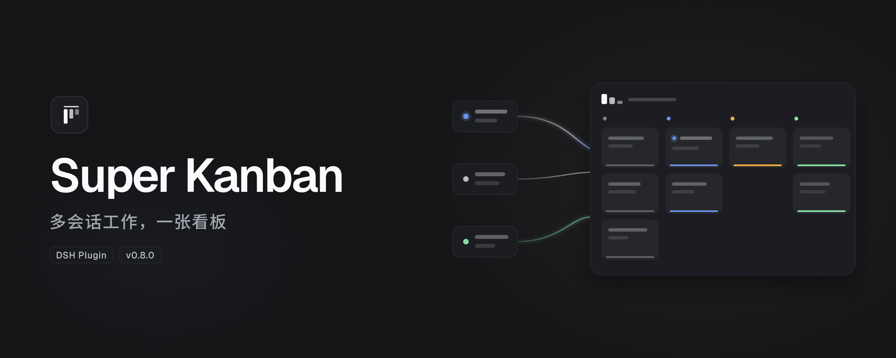
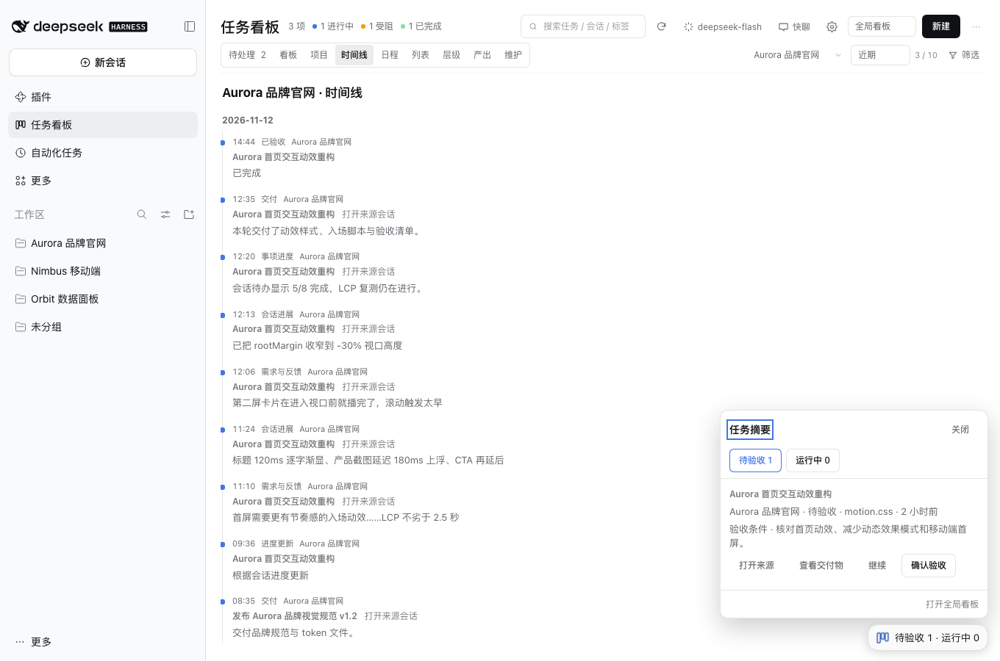
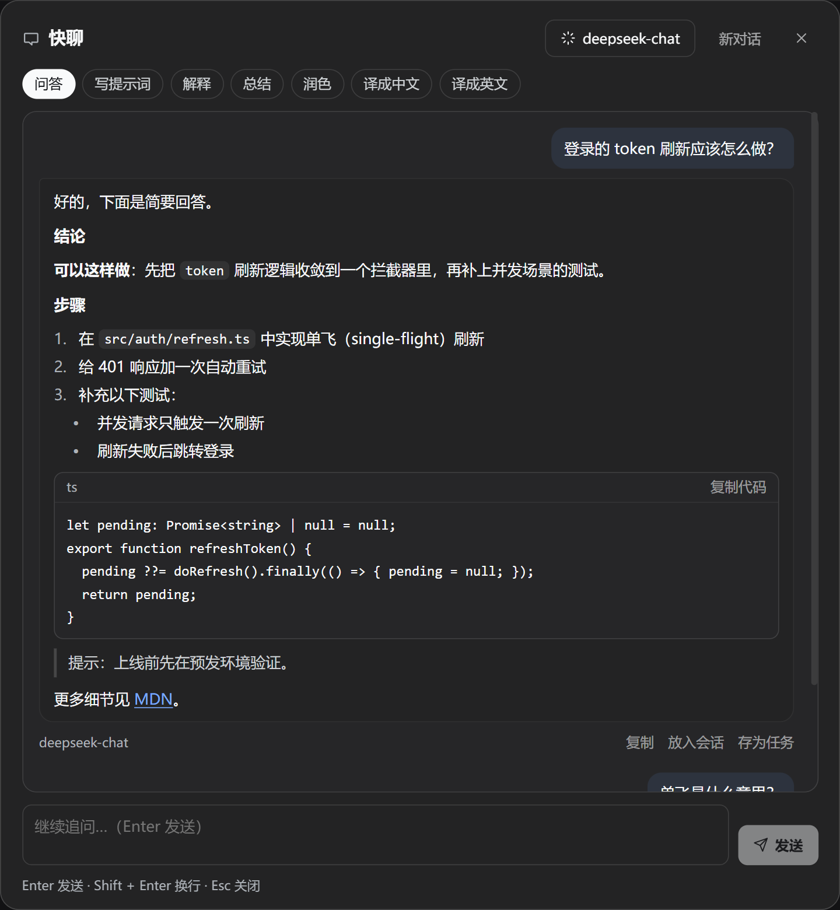

# Super Kanban · AI Task Command Center

**AI organizes your DSH sessions into tasks you can manage on one board.** Super Kanban pulls tasks out of DeepSeek Harness (DSH) conversations and keeps their progress, blockers, and deliverables up to date. See what is running, what needs your attention, and what is ready for review.

**English** | [简体中文](https://github.com/topmindspace/dsh-super-kanban/blob/main/README.md)

> The cover illustrates the workflow. [See the actual interface](#interface-demo).

## Quick start

### Install

- **Plugin market** · In DSH, open **Plugins → Discover** and add `https://topmindspace.github.io/dsh-super-kanban/index.json`. Open **Super Kanban**, choose a version, and install it. If Discover is missing, enable the experimental plugin market using the [installation guide](https://github.com/topmindspace/dsh-super-kanban/blob/main/docs/INSTALL.md#方式-a插件市场索引推荐).
- **npm** · Open **Plugins → Add plugin** and enter `dsh-super-kanban@0.10.1`. Replace `0.10.1` with the version you want.
- **Git or local folder** · Add the repository URL or select a local folder in the plugin page. To pin a version, check out its tag and follow the [source installation steps](https://github.com/topmindspace/dsh-super-kanban/blob/main/docs/INSTALL.md#方式-d本地目录源码脚本).

Enable the plugin and reload DSH. [Verify your version, upgrade, roll back, or uninstall](https://github.com/topmindspace/dsh-super-kanban/blob/main/docs/INSTALL.md)

### First run

1. Open **任务看板** (Task board) from the left sidebar. Inside a conversation, use the board icon at the top to dock the board on the right, or select the floating entry to expand the floating board.
2. Confirm the activity window in settings and select **扫描** (Scan). By default, incremental scans cover sessions active in the last 30 days. Check the scan button tooltip or Maintenance for results.
3. Open **待处理** (Inbox) to find sessions that need you, or open a task to see its acceptance criteria and main deliverable.
4. Review the deliverables and select **确认验收** (Confirm acceptance). To do more work, choose **继续此任务** (Continue task), review the draft, place it in a linked or new session, and send it yourself.

## Features

### Core concepts

- **Workspace** · A DSH working directory. It appears on the board automatically.
- **Project** · A group you create. It can collect tasks from several workspaces and carries notes, a due date, and an archive state.
- **Task** · One piece of work you can accept. It belongs to one workspace, can join one project, and can link several sessions, one of which is primary.
- **Session** · The DSH conversation where the work runs. The board extracts progress, blockers, and deliverables from sessions. Approvals and sending stay in the session.

### Follow multiple sessions

- **AI task organization** · Incremental scans extract goals, progress, blockers, and deliverables to create or update task cards. Link multiple sessions to one task. When auto-scan is enabled, a completed turn can bring the next scan forward.
- **Live status and inbox** · Filter running tasks. See pending approvals, questions, plan reviews, blockers, and work awaiting acceptance in one place, then jump straight to the session.
- **Full board, sidebar, and floating board** · The same board can fill the main area, dock beside the conversation, or float above it. Only one form shows at a time. The floating entry is on by default in conversations. Drag it where you like, or hide it from its context menu or in settings. Expand it to handle tasks awaiting acceptance, inbox items, running tasks, and recent tasks, jot down a quick to-do, or open quick chat.
- **Review strip** · When a turn ends, its card is pinned above the floating entry right away, even while a scan is busy. Click the card to return to that conversation; the green check that appears on hover is what marks it done. The card shows the session title with the workspace folder and relative time; opening its conversation tucks it away until you switch elsewhere (a lone green check stays above the launcher so you can still approve it), and only that conversation being running or waiting keeps it hidden — activity on a supporting session of the same task does not hide it or disable its check. A folder-initial chip in the workspace colour marks the source, and an overflowing title scrolls on hover. Three cards show at a time; the rest collapse into “N more”.
- **Long columns and quick actions** · Each column scrolls independently and shows up to 30 cards per page. The Done column can collapse and still accepts drops. Right-click a card or use its menu to move, pin, or archive it.

### Plan and deliver

- **Workspace projects, timelines, and schedules** · Included workspaces appear automatically in Projects. Custom projects can organize tasks across workspaces. Review task changes, session progress, and deliveries on the timeline, and track due dates in the schedule. Switch between recent and historical activity at any time.
- **Manual organization and recovery** · Create, drag, pin, and bulk archive tasks. Lock fields to keep manual edits. Manage dependencies, explicitly merge tasks, recover deleted tasks, and restore backups.
- **Evidence and human review** · See the goal, acceptance criteria, main deliverable, and source sessions. Preview artifacts, copy paths, or reveal files in the file manager. The task keeps a record of acceptance.
- **Continue with context** · Draft a handoff from the acceptance criteria, key decisions, unfinished work, and artifacts. Place it in a linked session or start a new session in the same workspace.

### Models and quick chat

- **Shared model selection** · Scans, reanalysis, polishing, and quick chat share the board's selected model. Follow the DSH default or choose another model configured in DSH. Scans use local rules when AI analysis is disabled or the model is unavailable.
- **Streaming quick chat** · Ask follow-up questions, or use one-shot modes to write a task prompt, explain, summarize, polish, or translate between Chinese and English. Replies render Markdown. Copy a reply, place it in the current session's input, save it as a task, or regenerate it. From task details, start a quick chat about that task with its summary attached as reference. The conversation lives only in the window's memory and clears when you reload the window or start a new chat.

## Interface demo

[Watch the animated demo](https://raw.githubusercontent.com/topmindspace/dsh-super-kanban/main/docs/screenshots/demo.gif) · [Browse all screenshots](https://github.com/topmindspace/dsh-super-kanban/blob/main/docs/SCREENSHOTS.md)

| Project overview | Project schedule |
| --- | --- |
|  |  |

| Dark board | Task details |
| --- | --- |
|  |  |

| Floating board | Quick chat |
| --- | --- |
|  |  |

> Screenshots use fictional demo data.

## AI and models

Configure models and credentials in **DSH Settings → Models**. Back on the board, follow the DSH default or select a specific model. [Configure a third-party model](https://github.com/topmindspace/dsh-super-kanban/blob/main/docs/TROUBLESHOOTING.md#接入第三方模型或自定义模型-api)

Scans have a default daily budget of 150 analysis units. You can adjust the per-scan budget. Later scans pick up remaining sessions. [Budgets and scan progress](https://github.com/topmindspace/dsh-super-kanban/blob/main/docs/TROUBLESHOOTING.md#ai-预算与剩余会话)

Task and project notes stay in `~/.dsh/storages/super-kanban/` on your machine. The plugin has no telemetry. When AI analysis is enabled, the selected model service receives a compact session digest and limited related task details. Polishing and quick chat send their respective inputs when you use them. [Security and privacy policy](https://github.com/topmindspace/dsh-super-kanban/blob/main/SECURITY.md)

## Compatibility

Requires DSH `>= 0.2.1-rc.5 < 0.3.0` and Node.js `>= 22.19.0` (bundled with DSH). Tested on macOS desktop. Other desktop platforms have yet to be individually verified. The plugin has no third-party runtime dependencies.

## Documentation and contributing

- **Usage** · [Install, upgrade, and uninstall](https://github.com/topmindspace/dsh-super-kanban/blob/main/docs/INSTALL.md) · [Daily workflows (Chinese)](https://github.com/topmindspace/dsh-super-kanban/blob/main/docs/WORKFLOWS.md) · [Troubleshooting](https://github.com/topmindspace/dsh-super-kanban/blob/main/docs/TROUBLESHOOTING.md)
- **Versions** · [Changelog](https://github.com/topmindspace/dsh-super-kanban/blob/main/CHANGELOG.md) · [Roadmap](https://github.com/topmindspace/dsh-super-kanban/blob/main/docs/ROADMAP.md)
- **Development** · [Contributing](https://github.com/topmindspace/dsh-super-kanban/blob/main/CONTRIBUTING.md) · [Developer guide](https://github.com/topmindspace/dsh-super-kanban/blob/main/docs/DEVELOPMENT.md) · [Architecture](https://github.com/topmindspace/dsh-super-kanban/blob/main/docs/ARCHITECTURE.md) · [API contract](https://github.com/topmindspace/dsh-super-kanban/blob/main/docs/CONTRACT.md)

Run `npm run check` for tests and validation. Please report security issues privately as described in the security policy.

[MIT License](https://github.com/topmindspace/dsh-super-kanban/blob/main/LICENSE) © topmindspace
