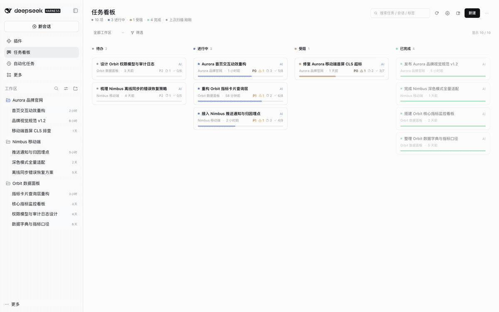
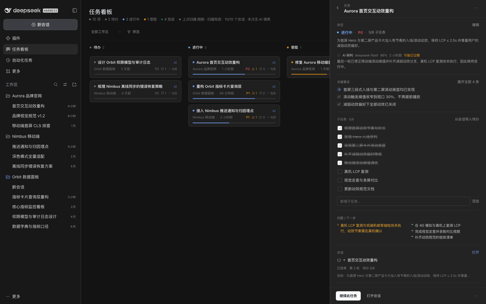
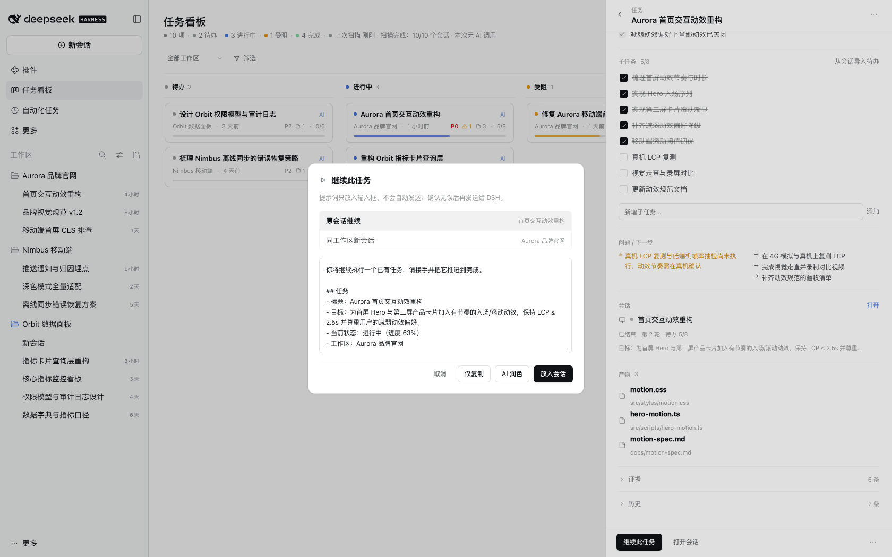
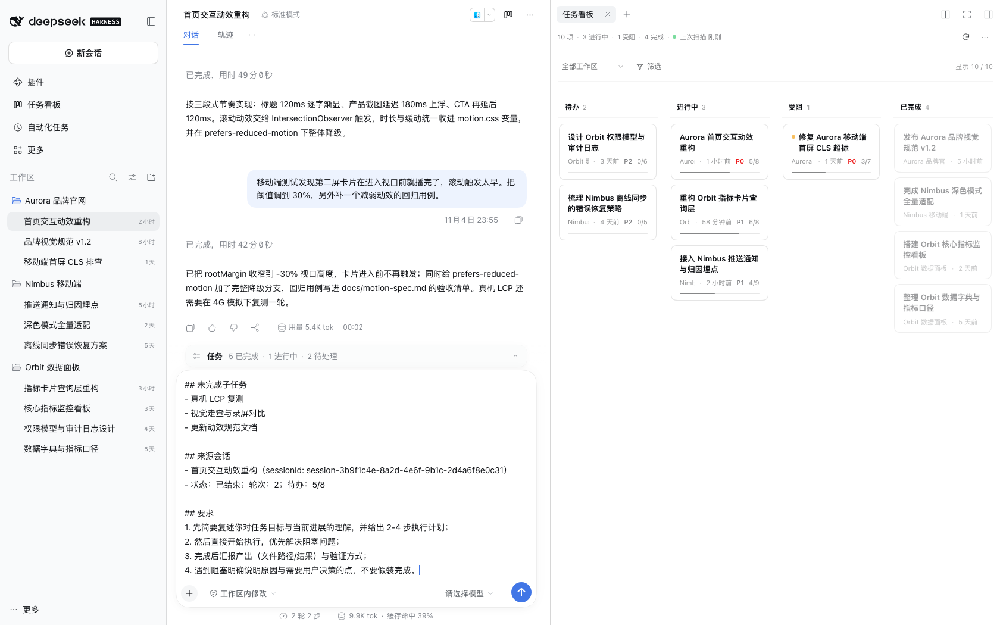
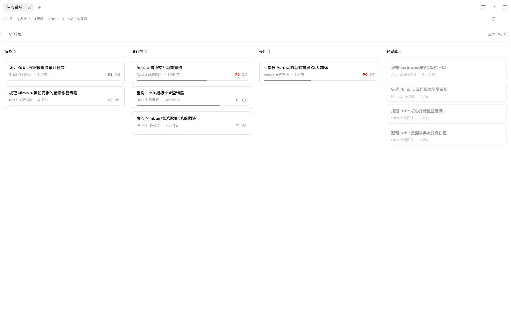
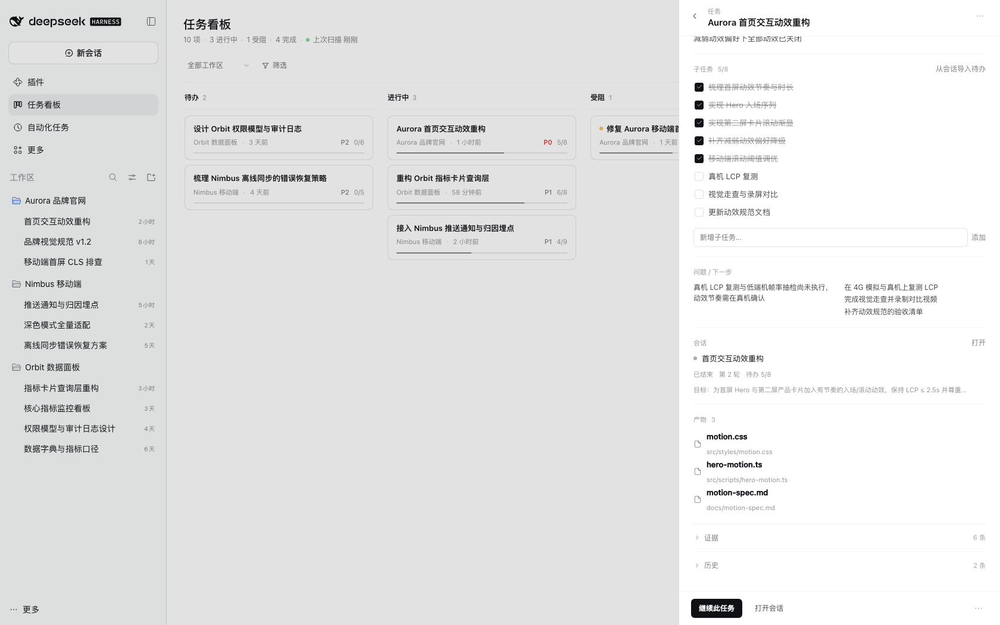
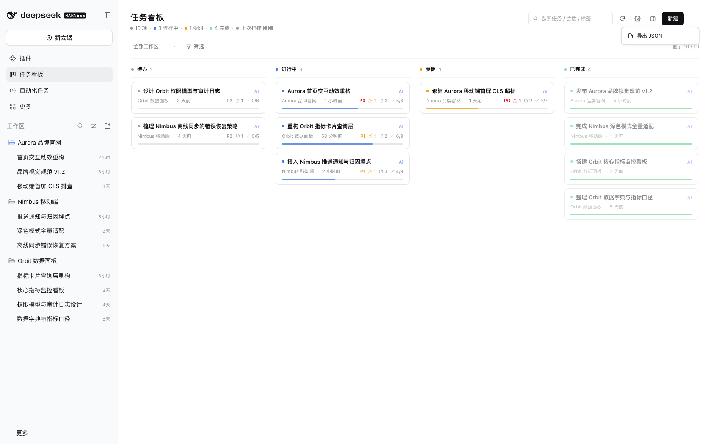
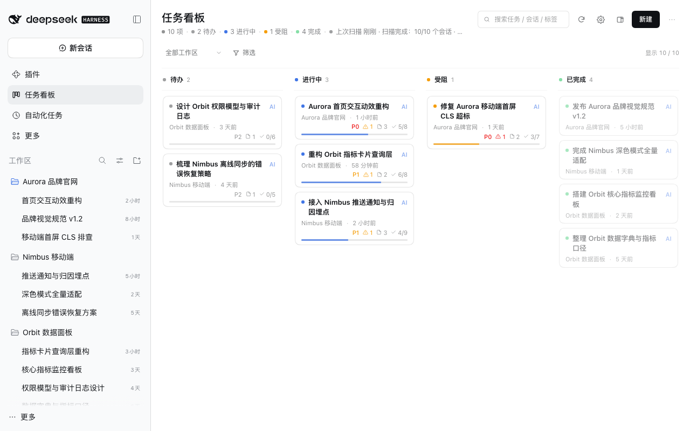

# Super Kanban · AI Task Command Center

[](https://github.com/topmindspace/dsh-super-kanban/actions/workflows/ci.yml)
[](https://www.npmjs.com/package/dsh-super-kanban)
[](https://github.com/topmindspace/dsh-super-kanban/blob/main/LICENSE)

An AI task board that **lives inside the DeepSeek Harness UI**. It reads the real DSH sessions across your workspaces and infers each task's goal, progress, completion state and open issues — and you can also maintain the board entirely by hand. Every card can be traced back to a specific session and a specific sentence.

- **Where it lives**: "任务看板" (Task board) in the DSH sidebar, or the compact form in the right sidebar of a conversation.
- **Data**: sessions are scanned read-only on your machine; board data stays on your machine.
- **Intelligence**: reuses the model quota of the DSH account already signed in on this machine — zero configuration. Turn AI off and it falls back to local rule-based analysis.

**English** | [简体中文](https://github.com/topmindspace/dsh-super-kanban/blob/main/README.md)




## Contents

- [Why Super Kanban](#why-super-kanban)
- [Features](#features)
- [Two layouts](#two-layouts)
- [Installation](#installation)
- [Usage](#usage)
- [AI and privacy](#ai-and-privacy)
- [Screenshots](#screenshots)
- [Compatibility](#compatibility)
- [FAQ](#faq)
- [Troubleshooting](https://github.com/topmindspace/dsh-super-kanban/blob/main/docs/TROUBLESHOOTING.md)
- [Development and contributing](#development-and-contributing)
- [License](#license)

## Why Super Kanban

You keep several workspaces and many sessions going in DSH at the same time, and task state is scattered across conversations: how far did this get? Where is it stuck? Was anything delivered? Did it quietly die?

Super Kanban turns those conversations into a maintainable board:

| Capability | Description |
| --- | --- |
| 🎯 Goal extraction | Derives the task title and goal from the real request in a session instead of using the whole prompt as a title |
| 📈 Progress estimation | Prefers todo completion inside the session, combined with deliverables and turn state |
| ✅ Completion detection | Combines the last assistant reply, deliverables (present / file writes) and whether the user asked for more changes |
| ⚠️ Issue detection | Tool errors, user corrections and unresolved questions are attached to the card as "issues" |
| 🔗 Traceability | Every card carries its source workspace / session / evidence timeline, with a jump back to the session |
| 🤝 Session hand-off | "Continue this task" builds a structured prompt and (after your confirmation) puts it in the original or a new session input — never sends automatically |
| ✅ Subtasks and goals | Subtask checklists (importable from session todos, writes back progress), task goal, and DSH Session Goal tracking |
| 📦 Artifact tracking | Collects deliverables and written files; click to open them in the DSH document preview |
| 🧾 Key facts first | Cards keep only title / meta / progress; the drawer leads with 3–6 key facts and keeps raw evidence collapsed |
| ✍️ Manual control | Create, edit, drag between columns, archive, delete, lock fields — AI never overwrites what you locked |
| 🔄 Continuous maintenance | First scan in seconds, then incremental scans; new sessions join automatically and old tasks keep updating |
| 🧠 Explainable | Every inference carries a confidence and a one-line reason — no black-box status changes |

## Features

### Two analysis engines: better with AI, always usable offline

1. **Collect (local)**: reads `workspace.json` and each session's `session.v4.jsonl.zstd`, parsing user requests, assistant replies, tool calls, todo snapshots, deliverables, errors and turn-end reasons.
2. **Rules engine (always available, zero tokens)**: local heuristics derive status, progress, issues and evidence. When you are signed out, offline, or AI is disabled, the board keeps working.
3. **LLM analysis (optional, online)**: sends a compressed session digest to the DeepSeek inference API and receives structured JSON (tasks, status, progress, issues, evidence, confidence, reason).
4. **Merge (local)**: merges results back by session anchor; locked fields are never overwritten; every change is recorded in task history.

### Token efficiency

- Session digests sent to the model are capped at **≤1.5KB per session**, containing only recent changes and key signals.
- Structured output is bounded: ≤6 key facts, ≤8 evidence items, `max_tokens` ≤ 2200, with per-session limits.
- **Incremental gating**: the model is called only when user messages increase, a turn ends, or the session is analyzed for the first time. Live turns are never re-analyzed, and there is a minimum interval per session.
- **Controllable budget**: per-scan and daily AI call limits are configurable; exceeding them automatically falls back to the rules engine. The settings page shows today's calls and tokens.
- Re-scanning already analyzed sessions results in **zero AI calls**.

### Data and privacy

- Board data is written only to `~/.dsh/storages/super-kanban/` on your machine. No third-party servers, no telemetry.
- Online analysis sends **compressed digests only**: never full session text, never file contents, never account credentials.
- All AI features can be disabled in settings and take effect immediately, falling back to local rules.

### Interface (v0.4)

- DSH-native light/dark themes, typography and spacing; "monochrome first with restrained accents": color only appears in status dots, thin progress lines, priority text and type icons.
- The header keeps frequent actions visible (search / scan / settings / open in right sidebar / new task); the "⋯" menu only contains "Export JSON".
- Full visual and interaction rules: [DESIGN.md](https://github.com/topmindspace/dsh-super-kanban/blob/main/docs/DESIGN.md).

## Two layouts

The same board can be opened in two ways:

| Layout | How to open | Characteristics |
| --- | --- | --- |
| **Full-page panel** | "任务看板" in the left sidebar | Full four-column board + filters + stats line, best for focused review |
| **Right sidebar** | Board icon in the conversation header, or "任务看板" in the right sidebar's "+" tools list | Board next to the chat; width-adaptive: narrow (single column + status segments) / medium / wide (four columns) |

- **Right sidebar fullscreen**: the fullscreen control on the right sidebar header expands the board to the whole viewport; you can leave it at any time.
- **Switching**: the "open in right sidebar" icon in the full-page header, or the "open as full page" icon in the right sidebar board.
- **Entry preferences**: board settings → "Display and entry" offers "Both (default) / Full page only / Right sidebar only"; refresh the window after changing.

## Installation

> Prerequisites: DSH desktop installed and opened at least once (`~/.dsh/profiles/desktop` exists); DSH version `>= 0.2.1-rc.5 < 0.3.0`.

### Option A: Plugin market index (recommended)

> "Discover" comes from DSH's experimental plugin market capability: first enable **Plugin market** under **Plugins → Experimental plugins** and reload DSH as prompted. If your DSH build does not offer it, use Option B/C/D.

1. DSH → **Plugins** → **Discover**
2. **Add index source** and paste:
   `https://topmindspace.github.io/dsh-super-kanban/index.json`
3. Find **Super Kanban** in the list → open its page (the index lists every available version) → **Install** the version you want → enable
4. Press `Cmd+R` in the DSH window (restart DSH if needed)

> The market index becomes available after the first release is published to GitHub Pages; its content comes from this repository's `docs/`.

### Option B: npm package

DSH → Plugins → Add plugin → enter the package name — `dsh-super-kanban` for npm latest, or an **exact version** such as `dsh-super-kanban@0.4.1` (recommended when upgrading) → install → enable → reload the window.

> The npm package is published: `dsh-super-kanban` (https://www.npmjs.com/package/dsh-super-kanban). See [docs/MARKET.md](https://github.com/topmindspace/dsh-super-kanban/blob/main/docs/MARKET.md) for the release and index-refresh flow.

### Option C: Git repository

Plugins → Add plugin → paste `https://github.com/topmindspace/dsh-super-kanban` → install (DSH pins the source to a commit) → enable → reload the window.

### Option D: Local directory / source install

For developers and users who want to track the source:

```bash
git clone https://github.com/topmindspace/dsh-super-kanban.git
cd dsh-super-kanban
./install.sh -y       # link into the default desktop profile and register the plugin
```

Or choose "local directory" in the DSH plugin page and point it at this repository root. After installing, reload the window and "任务看板" appears in the left sidebar.

### Updating the plugin (important)

Third-party plugins have **no automatic upgrade**: updating means **uninstall the old version → install the target version**, then reload DSH (fully quit and reopen if the UI still looks stale).

- **Cross-minor upgrades need an exact version**: going from `0.3.x` to `0.4.x` requires an exact install such as `dsh-super-kanban@0.4.1`. An old range such as `^0.3.0` **never** resolves to 0.4.x under semantic versioning — the most common cause of "updated but the UI is still old".
- **Within 0.4.x**: if the profile dependency is `^0.4.0`, patch releases (0.4.1, 0.4.2, …) resolve normally; plugin-page installs record an exact version, so those still require uninstall + reinstall.
- After updating press `Cmd+R`; if nothing changed, **fully quit and reopen DSH**, then verify the real installed version as described in [INSTALL.md](https://github.com/topmindspace/dsh-super-kanban/blob/main/docs/INSTALL.md#2-验证安装与版本).

### Uninstall

- **Uninstall**: remove it from the plugin page, or run `./uninstall.sh -y` in the source directory.
- Uninstalling **does not delete** board data; to wipe it, delete `~/.dsh/storages/super-kanban/`.

Detailed install / update / verification / rollback steps are in [docs/INSTALL.md](https://github.com/topmindspace/dsh-super-kanban/blob/main/docs/INSTALL.md); if something breaks see [docs/TROUBLESHOOTING.md](https://github.com/topmindspace/dsh-super-kanban/blob/main/docs/TROUBLESHOOTING.md).

## Usage

1. Click **任务看板** in the left sidebar (or the board icon in a conversation header for the right-sidebar form).
2. **Board**: four columns — Backlog / In progress / Blocked / Done; column headers show counts and status colors.
3. **Cards**: status dot, title with an AI/rules marker, source workspace and last-activity time, plus restrained priority, issue count, artifact count, subtask progress and a progress line.
4. **Detail drawer** (click a card):
   - One-line status summary (click "Edit" to change fields)
   - **Key facts** (3–6 items: key progress / decisions / issues from the session)
   - **Subtasks**: check / add / delete; "import todos from session"; progress writes back automatically
   - **Issues / next steps**
   - **Session linkage**: continue this task / open session
   - **Artifacts**: click to open in the DSH right-sidebar document preview
   - Evidence and history (collapsed by default)
5. **Filters**: workspace, priority, origin, tags, keyword search, show archived.
6. **Toolbar** (persistent in the header): search, scan, settings gear, open in right sidebar, new task; the "⋯" menu only contains "Export JSON".
7. **Scan**: click the scan button to trigger an incremental scan immediately; progress is shown live.
8. **Settings** (gear icon): AI toggle, auto-scan, scan interval, initial scan range, AI budget, display and entry, excluded workspaces.

### How "Continue this task" works

1. Open any card → click **"继续此任务"** in the drawer;
2. The dialog contains a structured prompt (task goal / progress / key facts / issues / next steps / source session) that you can edit;
3. Choose **original session** or **new session in the same workspace**;
4. Click **"放入会话"**: DSH switches to the target session and puts the prompt into the input box — **it is never sent automatically**; review or edit it and press send yourself. You can also "copy only" or "polish with AI".

> The prompt is assembled locally from a template — **0 tokens by default**. Only "Polish with AI" spends one model call.

### Manual and automatic side by side

- Automatic tasks are anchored to their source session; repeated scans update the same card instead of creating duplicates.
- Fields you edit and lock (editing locks by default) are never overwritten by AI; unlock them in the drawer to hand them back.
- Manual tasks (origin = manual) are never changed by automatic scans.
- New cards do not need a session; once linked, AI fills in the analysis on the next scan.

### Shortcuts

| Key | Action |
| --- | --- |
| `/` | Focus search |
| `n` | New task |
| `Esc` | Close the topmost overlay / drawer |
| `Cmd+R` | Reload the DSH window (needed after plugin updates) |

## AI and privacy

### Data flow

```
DSH sessions (local, read-only)
        │  local parsing / rules engine
        ▼
  local board storage ──（optional）digest ≤1.5KB ──► DeepSeek inference API
        │                                                  │
        └──────────── structured JSON ◄────────────────────┘
```

### What is never uploaded

- Full session transcripts, file contents, attachments
- Account credentials / tokens (read locally for the request header only, never included in the payload)
- Anything to third-party servers (no telemetry, no usage reporting)

### Turning AI off

Settings gear in the board header → turn off "AI 联网研判" (online AI analysis); it takes effect immediately. The board keeps running on the local rules engine — no missing features, just coarser inference.

### Cost

By default incremental scans only analyze **changed sessions**; the per-scan AI call limit defaults to 40 and the default model is `deepseek-flash`. On days without new conversations the cost is close to zero. You can lower the daily limit or disable AI entirely in settings.

## Screenshots

| Board (light) | Board (dark) |
| --- | --- |
|  |  |

| Task details (light) | Task details (dark) |
| --- | --- |
|  |  |

| Continue-task dialog | Prompt placed into the session input |
| --- | --- |
|  |  |

| Right sidebar (narrow) | Right sidebar fullscreen |
| --- | --- |
|  |  |

| Artifact preview entries | Settings (persistent gear) |
| --- | --- |
|  |  |

| "⋯" menu (export JSON only) | 1280px window |
| --- | --- |
|  |  |

> All screenshots above use a fully fictional demo dataset (invented workspaces / sessions / tasks) and contain no real user or workspace information.

## Compatibility

| Item | Requirement |
| --- | --- |
| DeepSeek Harness | `>= 0.2.1-rc.5 < 0.3.0` (verified on 0.2.1-rc.5 desktop) |
| Node.js | `>= 22.19.0` (uses the built-in `node:zlib` zstd API) |
| Platform | Verified on macOS desktop; other desktop platforms should work but are not individually verified |
| Third-party dependencies | None (plugin and tooling scripts are dependency-free) |

> The plugin relies on DSH's third-party plugin interfaces; major DSH upgrades may break compatibility. If the entry disappears after upgrading DSH, reinstall the plugin first — board data will not be lost.

## FAQ

**Q: I updated the plugin but the UI still looks old / new features are missing.**
A: The usual cause is an old profile dependency range (e.g. `^0.3.0`); cross-minor upgrades require an **exact version** such as `dsh-super-kanban@0.4.1`. Press `Cmd+R` first, then fully quit and reopen DSH. If it is still old, follow [docs/TROUBLESHOOTING.md](https://github.com/topmindspace/dsh-super-kanban/blob/main/docs/TROUBLESHOOTING.md#更新后-ui-未变) to check the real installed version and dependency spec.

**Q: There is no "任务看板" in the left sidebar.**
A: Press `Cmd+R` to reload the window; restart DSH if it is still missing. If it remains missing, check the diagnostics on the DSH plugin page (a failed plugin load usually reports a reason).

**Q: Cards are not updating / still show an old status.**
A: Click the scan button in the header to trigger a manual scan, or check that "Auto scan" is enabled in settings.

**Q: The AI judgment is wrong.**
A: Open the card and edit the fields directly (editing locks them, so AI won't overwrite them later). To make AI re-judge it, continue the source session and wait for the next scan — the card updates automatically.

**Q: I don't want certain workspaces on the board.**
A: Settings gear in the board header → Excluded workspaces (multi-select).

**Q: How much quota will this use?**
A: An incremental scan calls `deepseek-flash` once per **changed** session; the settings page shows today's calls and tokens. With AI disabled the cost is zero.

**Q: Where is the data? Is it lost after uninstalling?**
A: `~/.dsh/storages/super-kanban/` (`state.json` / `sessions-cache.json` / `backups/`). Uninstalling the plugin does not delete it.

**Q: Can I export the board?**
A: "⋯" in the board header → Export JSON, which downloads `super-kanban-YYYYMMDD.json`.

## Development and contributing

- Zero third-party dependencies; tests run with `node --test`; `scripts/` contains validators, the privacy scanner and the market index generator.
- Common commands:

```bash
npm test              # unit tests
npm run validate      # manifest, cordis patch, files and market index checks
npm run check:privacy # scan for personal paths / credentials / session ids
npm run market:index  # regenerate docs/index.json
```

- For the development setup, repository layout and debugging, see [CONTRIBUTING.md](https://github.com/topmindspace/dsh-super-kanban/blob/main/CONTRIBUTING.md) and [docs/DEVELOPMENT.md](https://github.com/topmindspace/dsh-super-kanban/blob/main/docs/DEVELOPMENT.md).
- Architecture: [docs/ARCHITECTURE.md](https://github.com/topmindspace/dsh-super-kanban/blob/main/docs/ARCHITECTURE.md). Interface contract: [docs/CONTRACT.md](https://github.com/topmindspace/dsh-super-kanban/blob/main/docs/CONTRACT.md). Visual spec: [docs/DESIGN.md](https://github.com/topmindspace/dsh-super-kanban/blob/main/docs/DESIGN.md).
- Release and distribution flow (market index, npm, Git): [docs/MARKET.md](https://github.com/topmindspace/dsh-super-kanban/blob/main/docs/MARKET.md).
- User-facing troubleshooting guide: [docs/TROUBLESHOOTING.md](https://github.com/topmindspace/dsh-super-kanban/blob/main/docs/TROUBLESHOOTING.md).
- For security issues, please follow [SECURITY.md](https://github.com/topmindspace/dsh-super-kanban/blob/main/SECURITY.md) and report privately instead of opening a public issue.

## License

[MIT](https://github.com/topmindspace/dsh-super-kanban/blob/main/LICENSE) © topmindspace
