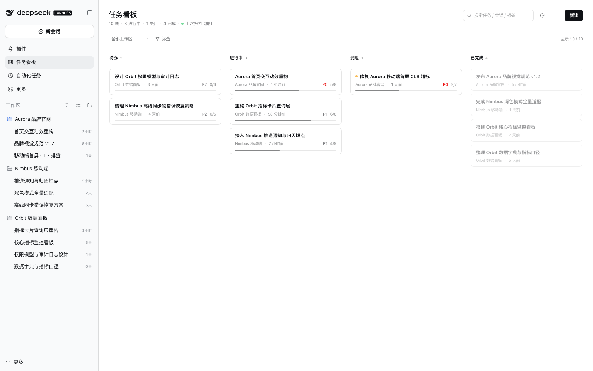
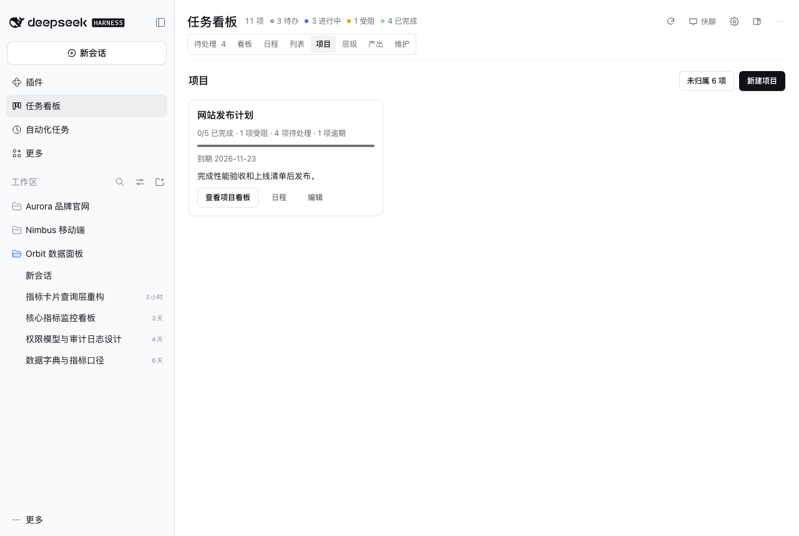
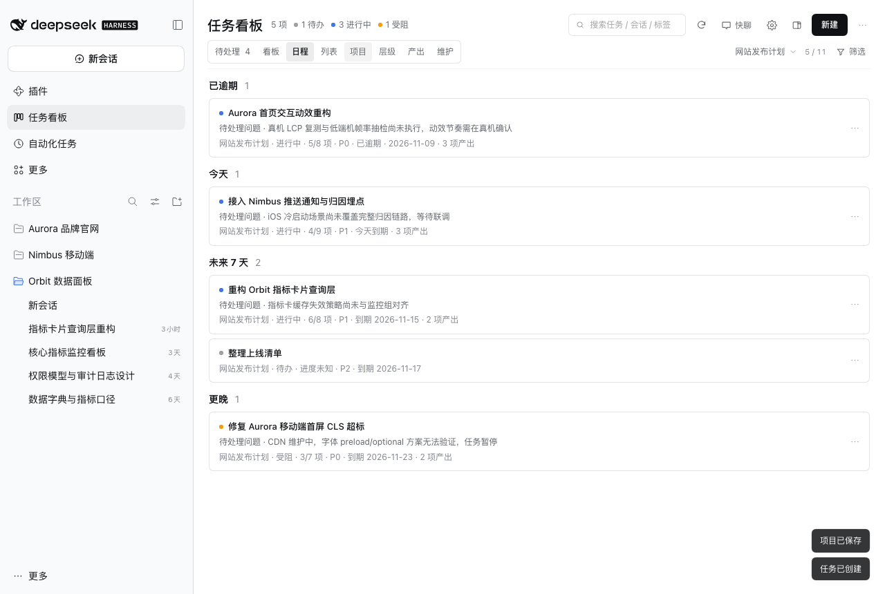
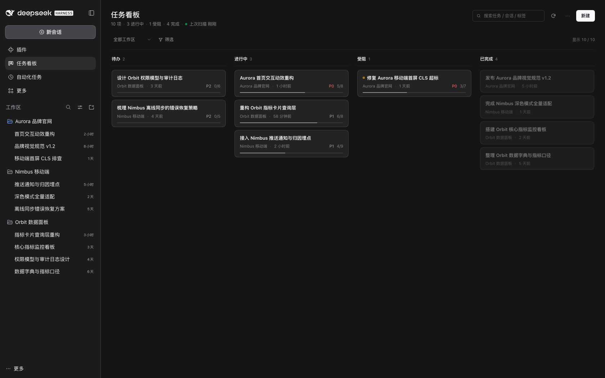
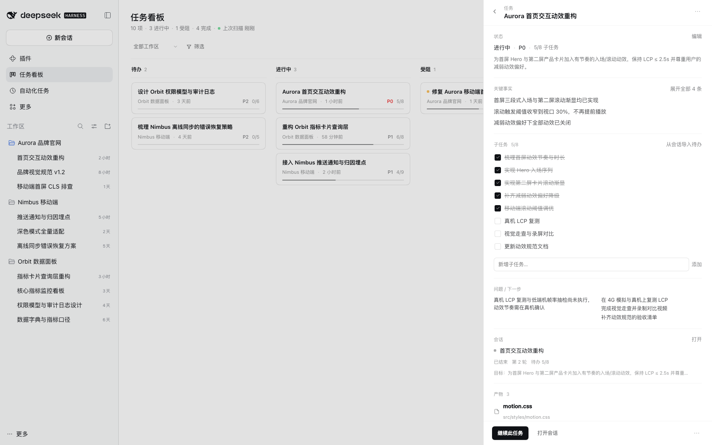
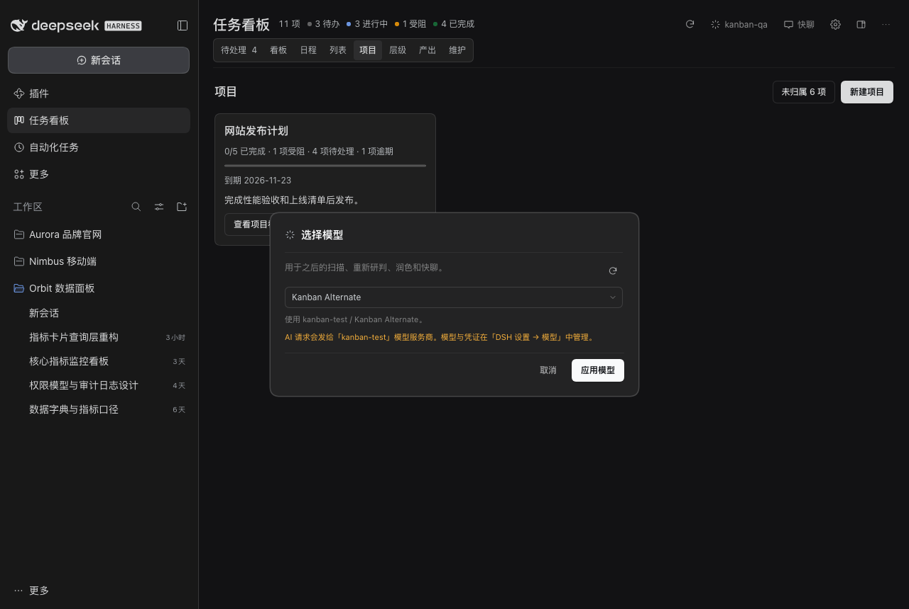
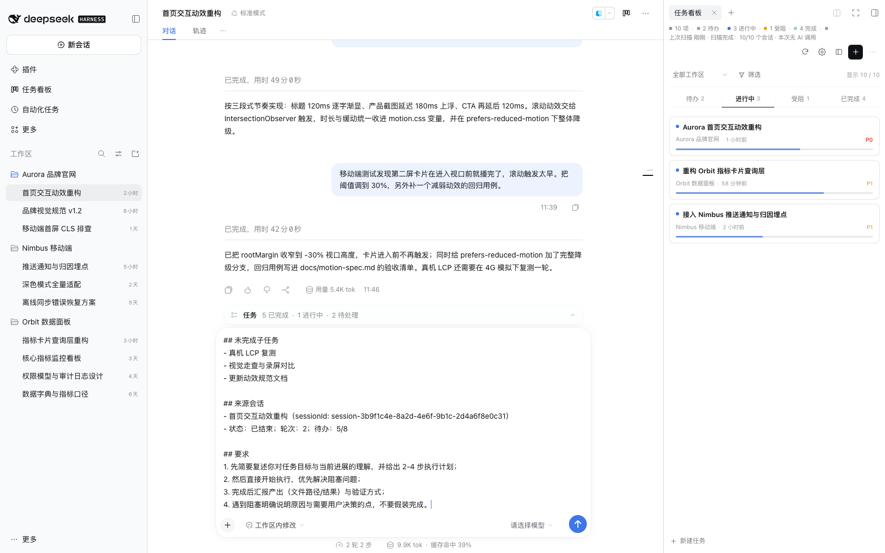

# Super Kanban · 智能任务指挥台

**在 DSH 里管理会自动更新的项目和任务。** 会话推进时，看板显示运行状态、待处理请求和交付证据。你可以按项目整理任务、加备注、排到期日，并从卡片打开对应会话继续。

**简体中文** | [English](https://github.com/topmindspace/dsh-super-kanban/blob/main/README.en.md)

> 要求 DSH `>= 0.2.1-rc.5 < 0.3.0` · Node.js `>= 22.19.0` · 零第三方依赖 · 无遥测

## 30 秒看懂

- **适合**：同时推进多个 DSH 会话，或想在同一个看板里规划项目、记录决策、跟进交付的人。
- **自动更新**。DSH 轮次结束后，增量扫描可以更新进度、问题和交付物；模型不可用时由本地规则继续处理。
- **人工规划**。项目归属、备注、到期日和手动锁定字段由你维护。

## 快速开始

### 安装（三种常用方式，另支持本地/源码安装）

三种常用方式都支持**安装特定版本**；本地目录 / 源码安装见步骤 3。

1. **插件市场（推荐）**：DSH → 插件 → 发现 → 添加索引源 `https://topmindspace.github.io/dsh-super-kanban/index.json` → 打开 **Super Kanban** 详情 → 在**版本列表**里选择精确版本（如 `0.8.0`）→ 安装 → 启用并刷新窗口。
2. **npm（精确版本）**：DSH → 插件 → 添加插件 → 输入 `dsh-super-kanban@0.8.0` → 安装 → 刷新窗口。命令行等价：`dsh plugin --profile desktop add dsh-super-kanban@0.8.0`。
3. **Git / 源码（tag 固定版本）**：`git clone https://github.com/topmindspace/dsh-super-kanban.git` → `git checkout v0.8.0` → `./install.sh -y` → 刷新窗口。`./install.sh` 需要 `bash` + `python3`；不想用命令行时，可在 DSH 插件页直接选择本地目录安装。在插件页添加仓库地址会 pin 到最新 commit；要固定版本请用这里的 tag。

[验证版本](https://github.com/topmindspace/dsh-super-kanban/blob/main/docs/INSTALL.md#23-命令行查看实际安装版本) · [升级](https://github.com/topmindspace/dsh-super-kanban/blob/main/docs/INSTALL.md#3-更新插件升级) · [回滚](https://github.com/topmindspace/dsh-super-kanban/blob/main/docs/INSTALL.md#4-回滚到旧版本) · [本地目录安装](https://github.com/topmindspace/dsh-super-kanban/blob/main/docs/INSTALL.md#方式-d本地目录源码脚本)——详细步骤见 [安装指南](https://github.com/topmindspace/dsh-super-kanban/blob/main/docs/INSTALL.md)。

### 第一次使用（5 步）

1. 左侧栏点 **任务看板**（或在会话右上角点看板图标，用右侧栏形态打开）。
2. 在 **设置** 确认扫描范围。启用 AI 时，模型默认跟随 DSH。
3. 点 **扫描**。首次扫描按会话量需要几秒到几分钟，扫描中可取消。悬停扫描按钮或在「维护」查看结果。
4. 打开 **待处理**，从卡片跳到等待操作的会话，或在详情查看验收条件和主交付物。
5. 点 **继续此任务** 或 **验收产出**。检查草稿后放入关联会话或新会话，由你发送。

## 它能做什么

- **先看需要你做什么**：待处理聚合审批、问题、依赖和待验收事项，支持直接打开相应会话。
- **一个目标，多条会话**：关联不同会话的进展与交付物。增量扫描更新已有任务。
- **按项目规划**：项目可以跨 DSH 工作区。手动维护备注与到期日，在「项目」查看完成率、受阻和逾期事项，在「日程」按到期时间浏览未完成任务。列表支持批量归属，工作区绑定可让未来的自动卡进入指定项目。
- **看清正在发生什么**：关联会话运行时显示动态圆点，点击工具栏的「运行中」筛出对应任务。审批、提问和方案审阅归入「待处理」。开启自动扫描后，会话轮次结束可提前触发增量更新。
- **对照验收条件交付**：详情显示主交付物、当前阻塞和按来源筛选的证据，人工验收保留确认记录。
- **直接操作任务与产物**：右键或点「⋯」可移动、置顶和归档任务。悬停产物可看来源与路径，菜单可复制文件名或路径、预览，以及通过 DSH 用默认应用打开或在文件管理器中显示。
- **带着上下文继续**：本地模板把验收条件、未完成事项与产物放进你选择的会话草稿。
- **看板与快聊共用模型**。工具栏显示当前模型，可切换 DSH 已配置的模型或跟随 DSH 默认。关闭 AI 研判或模型不可用时，扫描使用本地规则。
- **两种形态**：全页四列看板，或会话右侧栏紧凑看板。视图、工作区和筛选共用一条工具栏，窄栏将搜索收进筛选。
- **长列便于浏览**：每列独立滚动，每页最多 30 张卡。「已完成」列可折叠，折叠后仍能拖入任务。
- **手动管理与恢复**：置顶、批量归档、锁定字段和显式合并。维护视图提供回收站与备份恢复。
- **快聊**。连续追问或单次中英翻译，流式显示，可停止和逐条复制。切换模型保留可见回答，下一轮从新上下文开始。
- **本地优先**：数据只写本机 `~/.dsh/storages/super-kanban/`，看板自身无遥测。

## 典型场景

- **每天早上 30 秒**：打开「待处理」找出需要介入的会话，再用看板四列浏览进度。
- **把一张卡继续下去**：抽屉点「继续此任务」，提示词直接放回原会话或同工作区新会话，不用自己拼上下文。
- **手动维护大看板**：新建、拖拽、锁定字段；锁过的字段不会被下一次 AI 研判覆盖。
- **从会话整理出项目**：在「项目」新建项目，再到「列表」多选任务并应用项目归属。打开项目看板后新建任务会预选该项目。已归档项目仍可查看和恢复。

## AI 与模型

- **默认跟随 DSH 默认模型**，看板里不需要填任何 Key。
- **想用第三方模型**：在 **DSH 设置 → 模型** 添加模型提供方（OpenAI / Anthropic / OpenRouter 等，或自定义兼容端点）并填 API Key；回到看板点「选择模型」，选中模型后点「应用模型」。下一次模型调用生效，DSH 的默认设置保持原值。
- **没有原生模型服务**（旧 DSH / 极简组合）时自动改用本地规则引擎，扫描结论会说明原因。
- **隐私**：AI 研判发送压缩会话摘要和少量相关任务信息。项目和任务备注保存在本机。主动点击「AI 润色」会发送当前草稿，快聊发送当前输入，问答可带上同一模型最近四轮的已完成问答。关闭快聊即清空本地记录。接收方为 DSH 配置的模型服务。详见 [SECURITY.md](https://github.com/topmindspace/dsh-super-kanban/blob/main/SECURITY.md)。

## 设置与预算

- **AI 预算**：默认「自动」＝本次最多用完当日剩余额度；也可固定为 20 / 40 / 80 / 150 次。
- **每日上限**。默认 150 个研判单位，本机午夜重置。失败研判与润色也计入，同一次内部重试共用一个单位。快聊由当前模型提供方单独计量。
- **扫描**：自动扫描间隔可调；一次扫不完的会话下次继续，结论会提示「剩余 N 个会话下次扫描继续」。
- **入口偏好**：「显示与入口」可选两者 / 仅全局面板 / 仅会话右侧栏；保存后刷新窗口生效。

## 性能与限制

- **增量扫描**：只处理有变化的会话，日常开销很小；只有你主动「全量重扫」时才会完整解析。
- **初始扫描范围**：默认最近 30 天，可在设置中改为 7 / 14 / 30 / 90 天。
- **AI 额度与时长**：单次扫描有预算单位上限，AI 阶段最多约 10 分钟；超出后提示「剩余 N 个会话下次扫描继续」，不会丢。
- **大库首扫**：会话很多时首次扫描可能跨多轮完成；可随时取消，已完成部分保留。
- **数据体积**：看板数据在 `~/.dsh/storages/super-kanban/`（任务 / 设置 / 扫描状态 + 会话缓存），无遥测。

## 界面截图

| 项目管理 | 项目日程 |
| --- | --- |
|  |  |

| 看板（深色） | 任务详情 |
| --- | --- |
|  |  |

| 模型选择 | 右侧栏形态 |
| --- | --- |
|  |  |

更多截图：[演示动图](https://raw.githubusercontent.com/topmindspace/dsh-super-kanban/main/docs/screenshots/demo.gif)、[深色任务详情](https://raw.githubusercontent.com/topmindspace/dsh-super-kanban/main/docs/screenshots/drawer-dark.png)、[继续任务](https://raw.githubusercontent.com/topmindspace/dsh-super-kanban/main/docs/screenshots/continue-modal.png)、[提示词放入会话](https://raw.githubusercontent.com/topmindspace/dsh-super-kanban/main/docs/screenshots/continue-placed.png)、[右侧栏全屏](https://raw.githubusercontent.com/topmindspace/dsh-super-kanban/main/docs/screenshots/side-fullscreen.png)、[产物预览](https://raw.githubusercontent.com/topmindspace/dsh-super-kanban/main/docs/screenshots/drawer-artifacts.png)、[窄屏快聊](https://raw.githubusercontent.com/topmindspace/dsh-super-kanban/main/docs/screenshots/chat-narrow.png)。

> 截图来自一套完全虚构的演示数据，不含任何真实用户或工作区信息。

## 兼容性

| 项 | 要求 |
| --- | --- |
| DeepSeek Harness | `>= 0.2.1-rc.5 < 0.3.0` |
| Node.js | `>= 22.19.0`（DSH 自带，无需单独安装） |
| 平台 | macOS 桌面版已验证；其他桌面平台理论可用但未逐一验证 |
| 第三方依赖 | 无（插件与 `scripts/` 校验脚本均为零依赖） |
| AI 模型 | 由 DSH 原生模型服务提供：默认跟随 DSH 默认模型，也可选第三方 provider |

**版本策略**：当前 `0.8.x` 线主动接收安全修复；上一线 `0.7.x` 建议升级到 `0.8.x`（安全修复尽力维护）；GitHub Releases 只保留最近 3 个版本页面，历史版本请在插件市场版本列表或 Git tag 中用精确版本安装。详见 [SECURITY.md](https://github.com/topmindspace/dsh-super-kanban/blob/main/SECURITY.md) 与 [INSTALL.md](https://github.com/topmindspace/dsh-super-kanban/blob/main/docs/INSTALL.md#3-更新插件升级)。跨 minor 升级必须安装精确版本；DSH 大版本升级后如入口消失，先重装插件，看板数据不会丢。

## 常见问题

**Q：左侧栏没有「任务看板」？**
A：按 `Cmd+R` 刷新窗口；仍没有就完全退出 DSH 再打开。还没有请看插件页的加载诊断，或 [排障手册](https://github.com/topmindspace/dsh-super-kanban/blob/main/docs/TROUBLESHOOTING.md#入口缺失)。

**Q：AI 不生效 / 一直显示「规则」？**
A：确认设置里「AI 联网研判」开启，并在 DSH 设置 → 模型中配置好模型；点工具栏的「选择模型」检查当前选择。模型不可用时，扫描结论会说明原因。

**Q：怎么更新到特定版本？**
A：第三方插件没有自动升级：卸载旧版 → 安装目标精确版本（如 `dsh-super-kanban@0.8.0`，或在市场版本列表里选择）→ 刷新窗口。步骤见 [INSTALL.md](https://github.com/topmindspace/dsh-super-kanban/blob/main/docs/INSTALL.md#3-更新插件升级)。

**Q：数据存在哪？卸载会丢吗？**
A：`~/.dsh/storages/super-kanban/`（`state.json` / `sessions-cache.json` / `backups/`）。卸载插件不会删除数据；彻底清空见 [排障手册](https://github.com/topmindspace/dsh-super-kanban/blob/main/docs/TROUBLESHOOTING.md#卸载与数据保留)。

**Q：怎么卸载？**
A：插件页移除，或源码目录执行 `./uninstall.sh -y`，然后刷新窗口。

## 文档导航

- 安装 / 升级 / 回滚 / 卸载：[INSTALL.md](https://github.com/topmindspace/dsh-super-kanban/blob/main/docs/INSTALL.md)
- 排障（入口 / AI / 扫描 / 预算）：[TROUBLESHOOTING.md](https://github.com/topmindspace/dsh-super-kanban/blob/main/docs/TROUBLESHOOTING.md)
- 安全与隐私边界：[SECURITY.md](https://github.com/topmindspace/dsh-super-kanban/blob/main/SECURITY.md)
- 开发与维护：[DEVELOPMENT.md](https://github.com/topmindspace/dsh-super-kanban/blob/main/docs/DEVELOPMENT.md)、[MARKET.md](https://github.com/topmindspace/dsh-super-kanban/blob/main/docs/MARKET.md)、[ARCHITECTURE.md](https://github.com/topmindspace/dsh-super-kanban/blob/main/docs/ARCHITECTURE.md)、[CONTRACT.md](https://github.com/topmindspace/dsh-super-kanban/blob/main/docs/CONTRACT.md)、[DESIGN.md](https://github.com/topmindspace/dsh-super-kanban/blob/main/docs/DESIGN.md)
- [产品路线图](https://github.com/topmindspace/dsh-super-kanban/blob/main/docs/ROADMAP.md)

## 开发与贡献

- 零第三方依赖、无构建：Host 为 Node ESM，浏览器半边为单文件 `client.js`；`npm test` 跑测试，`npm run check` 一次跑完全部校验。
- 目录结构与调试见 [CONTRIBUTING.md](https://github.com/topmindspace/dsh-super-kanban/blob/main/CONTRIBUTING.md) 与 [docs/DEVELOPMENT.md](https://github.com/topmindspace/dsh-super-kanban/blob/main/docs/DEVELOPMENT.md)。
- 安全问题请按 [SECURITY.md](https://github.com/topmindspace/dsh-super-kanban/blob/main/SECURITY.md) 私下报告，不要开公开 issue。

## License

[MIT](https://github.com/topmindspace/dsh-super-kanban/blob/main/LICENSE) © topmindspace
