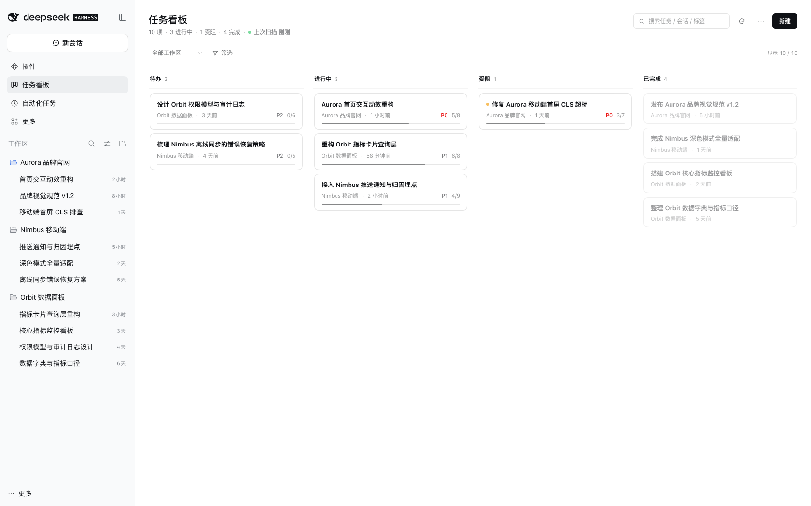
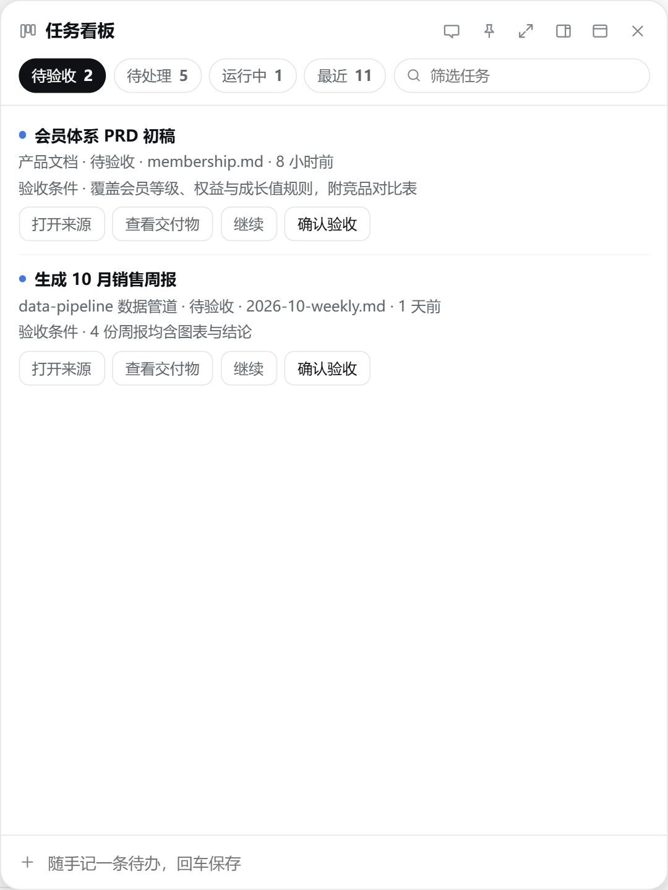
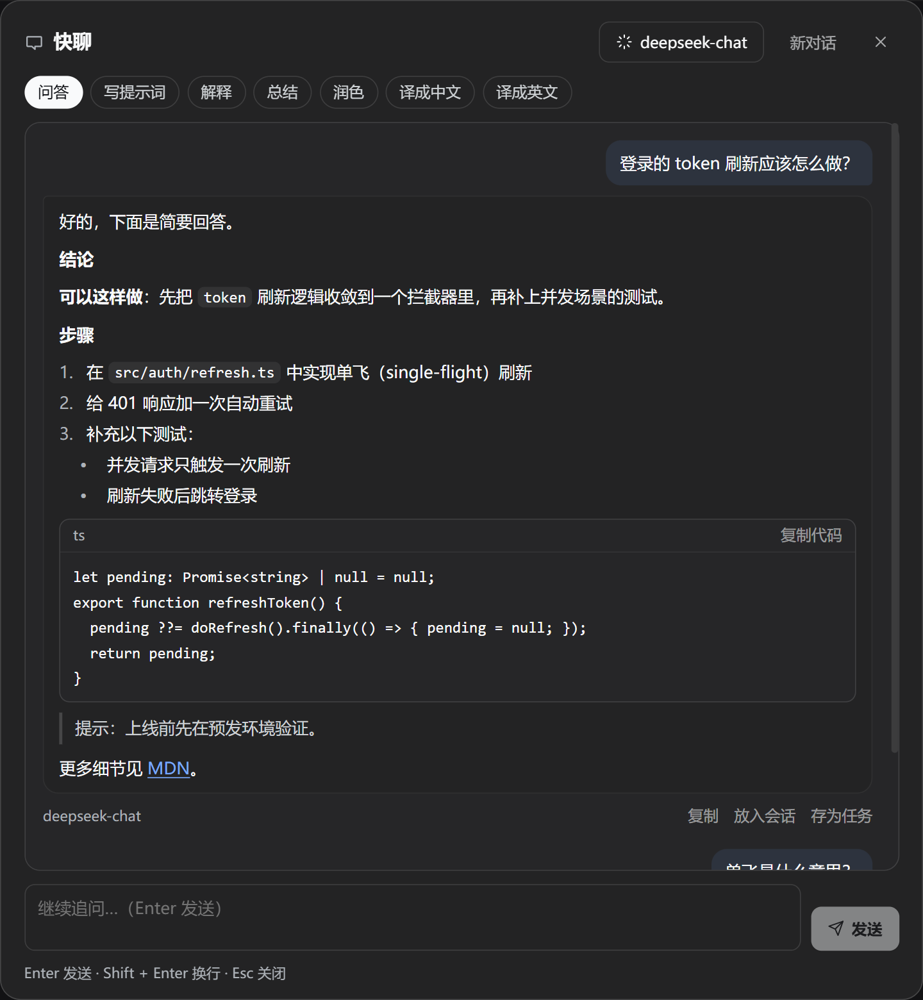
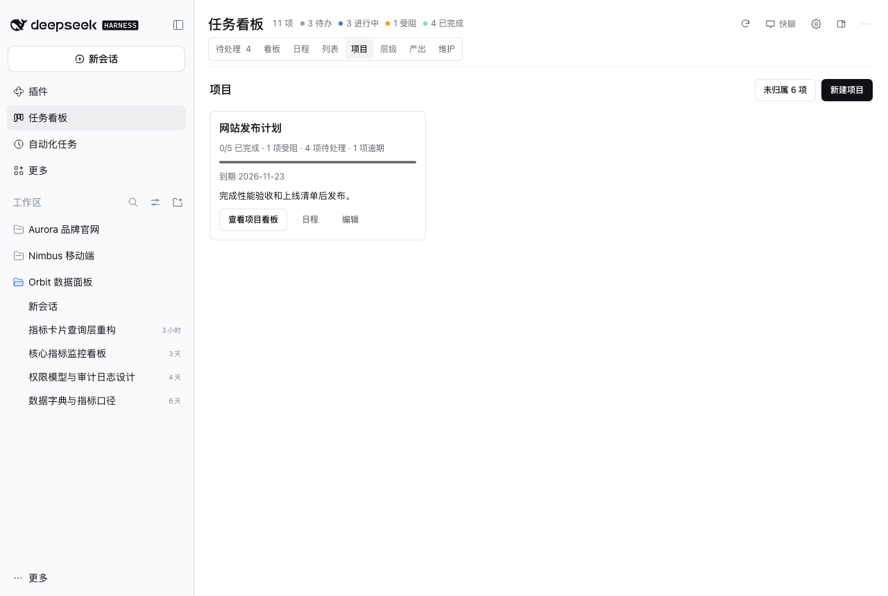
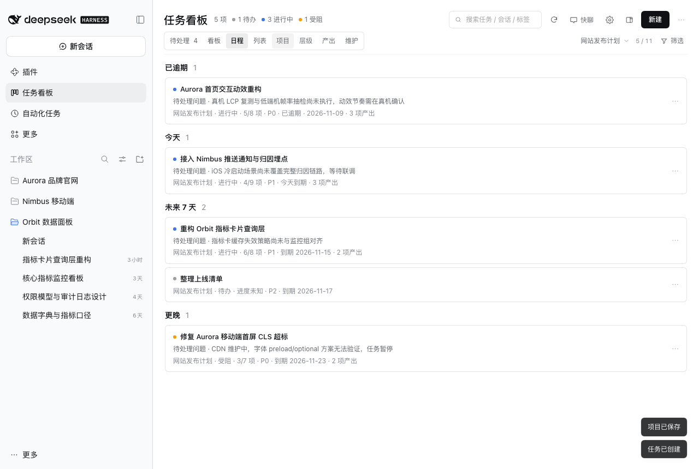
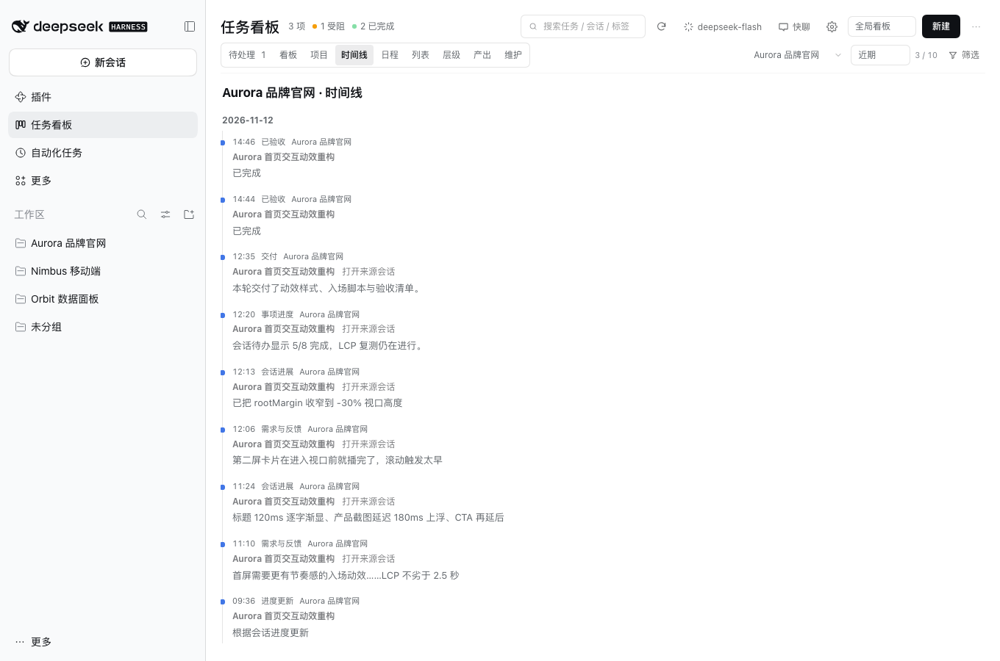
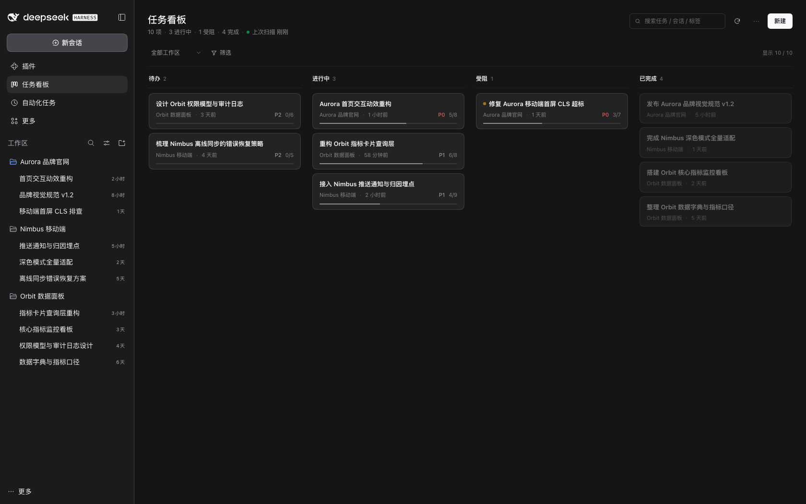
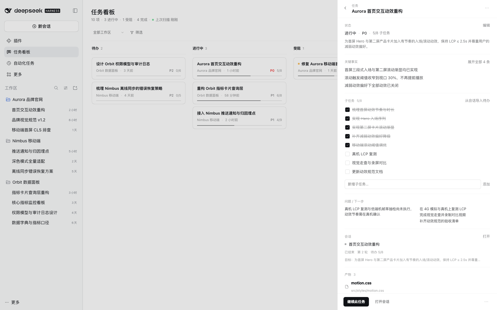
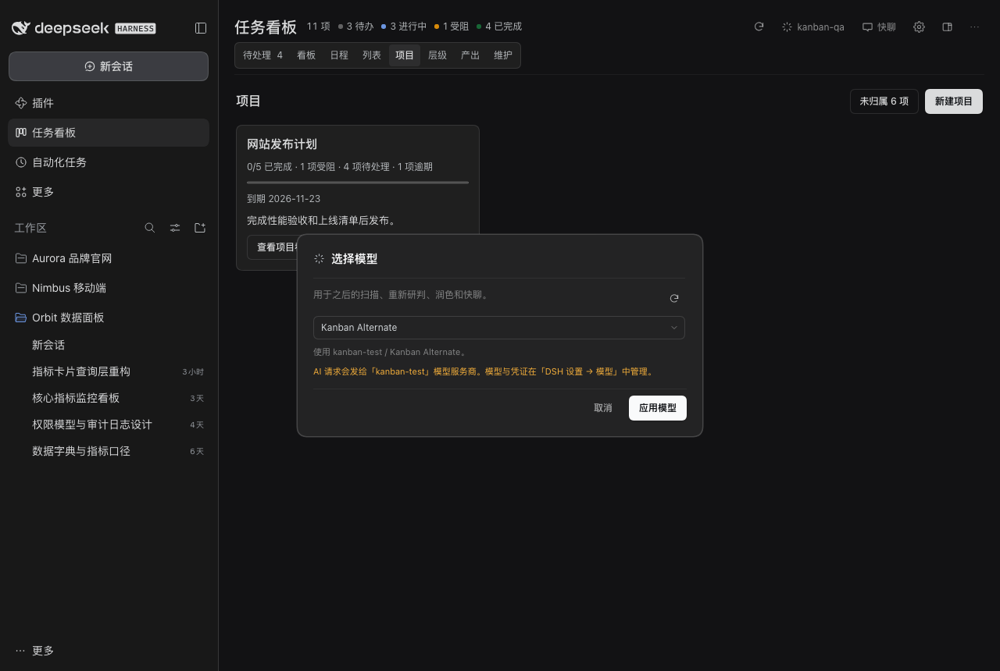

# 界面截图 / Screenshots

[简体中文](../README.md) | [English](../README.en.md)

| 悬浮看板 / Floating board | 快聊 / Quick chat |
| --- | --- |
|  |  |

| 项目管理 / Projects | 项目日程 / Schedule |
| --- | --- |
|  |  |

| 项目时间线 / Project timeline | 看板（深色） / Board (dark) |
| --- | --- |
|  |  |

| 任务详情 / Task details | 模型选择 / Model selection |
| --- | --- |
|  |  |

## 操作演示 / Workflow demos

- [演示动图 / Animated demo](https://raw.githubusercontent.com/topmindspace/dsh-super-kanban/main/docs/screenshots/demo.gif)
- 续做 / Continue a task · [生成续做草稿 / Draft a handoff](https://raw.githubusercontent.com/topmindspace/dsh-super-kanban/main/docs/screenshots/continue-modal.png) · [放入会话 / Place it in a session](https://raw.githubusercontent.com/topmindspace/dsh-super-kanban/main/docs/screenshots/continue-placed.png)
- 验收 / Review deliverables · [深色任务详情 / Dark task details](https://raw.githubusercontent.com/topmindspace/dsh-super-kanban/main/docs/screenshots/drawer-dark.png) · [产物预览 / Artifact preview](https://raw.githubusercontent.com/topmindspace/dsh-super-kanban/main/docs/screenshots/drawer-artifacts.png)
- 右侧看板 / Docked board · [会话侧栏 / Conversation sidebar](https://raw.githubusercontent.com/topmindspace/dsh-super-kanban/main/docs/screenshots/side-panel.png) · [右侧栏全屏 / Fullscreen sidebar](https://raw.githubusercontent.com/topmindspace/dsh-super-kanban/main/docs/screenshots/side-fullscreen.png)

> 截图使用虚构的演示数据，不含真实用户或工作区信息。悬浮看板和快聊截取自 0.10 版本，其余截图的工具栏在 0.10 中把形态下拉改为三个图标。
> Screenshots use fictional demo data and contain no real user or workspace information. The floating board and quick chat were captured on 0.10. In the other shots, 0.10 replaces the surface drop-down with three icons.
